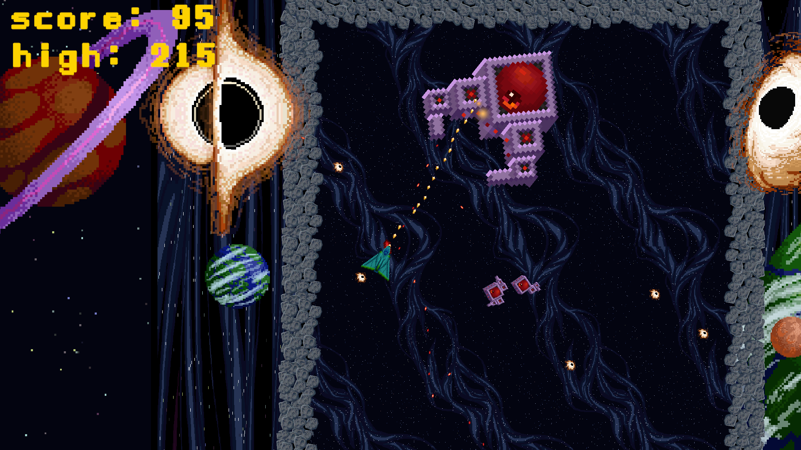

# 2D Space Shooter — Unity

A 2D space shooter project with five level scenes, mouse aiming, projectile combat, enemy movement, and score tracking. The repository contains the Unity source project and gameplay screenshots.



## Project details

| Item | Details |
| --- | --- |
| Unity Editor | 2022.3.62f3 |
| Language | C# |
| Input | Unity Input System 1.14.2 |
| Physics | Unity 2D physics |
| Build scenes | MainMenu, Level1, Level2, Level3, Level4, Level5 |

## Gameplay represented in the project

- Keyboard movement and mouse-directed aiming, configured in the player prefab.
- Player and enemy projectile firing, with configurable firing intervals and projectile spread.
- Enemy movement and shooting behavior implemented in `Enemy.cs` and `ShootingController.cs`.
- Health, damage, hit effects, and death handling.
- Current score and local high-score storage using `PlayerPrefs`.
- Level completion based on defeated-enemy counts, plus victory and game-over UI.
- Pause input and level navigation. The scene configuration progresses from Level1 through Level5, then back to MainMenu.

The serialized defeat targets for Level1–Level5 are **4, 5, 6, 4, and 4**, respectively. These are completion settings, not a guarantee that each level has been playtested.

## Controls

| Action | Configured input |
| --- | --- |
| Move | WASD or arrow keys |
| Aim | Mouse position |
| Fire | Left mouse button |
| Pause / resume | Escape |

Controls are taken from the player prefab and level-scene input overrides.

## Open the project

1. Clone or download this repository.
2. In Unity Hub, add the repository root containing `Assets`, `Packages`, and `ProjectSettings`.
3. Open it with **Unity 2022.3.62f3** and allow package resolution and asset import to finish.
4. Open `Assets/_Scenes/MainMenu.unity` and enter Play mode.
5. For a local build, open Build Settings, confirm the six enabled scenes listed above, and install the Unity build-support module for your chosen target.

No successful build, platform compatibility, or performance result is asserted by this README. The documented features were checked against source files, scene/prefab data, and existing screenshots; runtime behavior still needs verification.

## Repository layout

```text
Assets/
  _Scenes/       Main menu and five level scenes
  Scripts/       Player, enemies, projectiles, health, camera, UI, utilities
  Prefabs/       Reusable player, enemy, UI, management, and effect objects
  Art/           Visual assets
  Audio/         Audio assets and included documentation
  Imported Custom Asset Packages/  Includes Developer Console
Packages/        Package manifest and lock file
ProjectSettings/ Editor version and project/build settings
Screenshots/     Five committed gameplay images
```

## Implementation references

- [Player controls](Assets/Scripts/Player/Controller.cs)
- [Projectile firing](Assets/Scripts/ShootingProjectiles/ShootingController.cs)
- [Enemy behavior](Assets/Scripts/Enemies/Enemy.cs)
- [Scoring and level completion](Assets/Scripts/Utility/GameManager.cs)
- [Build scene list](ProjectSettings/EditorBuildSettings.asset)

`EnemySpawner.cs` also exists, but the reviewed main level scenes and their referenced prefab chains did not reference that component. Its presence alone should not be presented as an active wave-spawning feature.

## Credits and scope of authorship

This repository includes imported assets and utility code. `ScreenshotUtility.cs` credits **Brian Winn, Michigan State University, Games for Entertainment and Learning (GEL) Lab**. The repository also includes a Developer Console package, TextMesh Pro resources, a font license, and MSU audio documentation.

Repository ownership does not establish authorship of every script, asset, or gameplay system. The maintainer's specific original contributions and any AI-assisted changes have not been established by this source review. A contribution statement should be added only after those details are confirmed, with third-party credits preserved.

No root project license was found in the reviewed snapshot. Check the included asset documentation and applicable permissions before redistributing assets or applying a project-wide license.

## Review scope

Prepared from commit `5482a0cbc3d7447e4860d6b3c2ebd68bdb3753ab`. This documentation is based on static inspection, not a Unity Editor playthrough.
